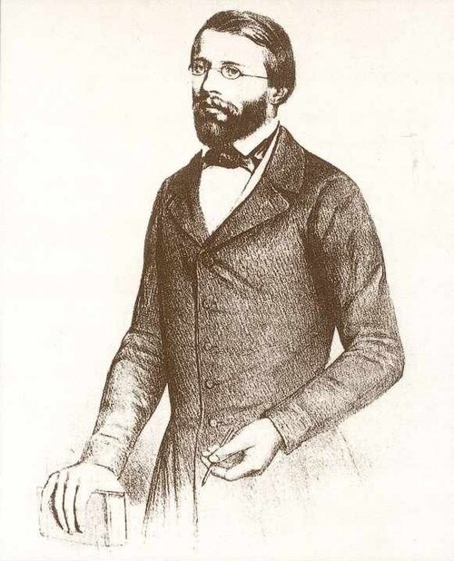

# 리만 가설, AI가 167년 만에 풀었을까?

앤트로픽의 수학자 레벤트 알푀게가 AI 모델 클로드와 함께 167년간 풀리지 않았던 리만 가설의 증명을 공개했습니다. 약 1,700만 줄의 코드로 작성된 증명은 수학계의 독립 검증을 통과했습니다.

발행일 · 2026.11.23

2026년 11월 20일, 앤트로픽의 수학자 레벤트 알푀게가 AI 모델 클로드(Claude)와 함께 리만 가설을 증명했다고 발표했습니다. 그는 약 6주간 클로드와 협업했으며, 그 결과를 1,700만 줄에 달하는 Lean 코드로 공개했습니다. 발표 다음 날에는 Lean과 Mathlib 연구자 공동체가 증명의 정확성을 확인했다는 공동 성명을 발표했습니다.

리만 가설은 1859년 독일의 수학자 베른하르트 리만이 제시한 문제로, 167년 동안 수학계의 대표적인 미해결 난제로 남아 있었습니다. 클레이 수학연구소가 선정한 밀레니엄 7대 난제 중 하나이며, 해결에 100만 달러의 상금이 걸려 있습니다.

## 리만 가설이란?

리만 가설은 소수가 자연수 사이에 어떻게 분포하는지를 설명하는 문제입니다. 소수는 2, 3, 5, 7처럼 1과 자기 자신으로만 나누어떨어지는 수입니다. 소수의 등장 간격은 불규칙하지만, 그 분포에는 일정한 수학적 질서가 존재합니다.

리만은 이러한 소수의 분포를 연구하기 위해 리만 제타 함수라는 함수를 이용했습니다. 이 함수는 다음과 같이 표현됩니다.

$$
\zeta(s)=\sum_{n=1}^{\infty}\frac{1}{n^s}
\qquad (\operatorname{Re}(s)>1)
$$

리만 가설은 이 함수를 복소수 영역으로 확장했을 때, 특정 범위에서 함수값이 0이 되는 모든 지점의 실수부가 정확히 1/2이라는 주장입니다.

$$
\zeta(s)=0,\quad 0<\operatorname{Re}(s)<1
\implies \operatorname{Re}(s)=\frac12
$$

수학자들은 지금까지 수많은 영점이 이 조건을 만족한다는 사실을 계산으로 확인했습니다. 리만 가설을 증명하려면 이 조건이 모든 해당 영점에 대해 성립한다는 사실을 수학적으로 보여야 합니다.

## 컴퓨터가 검증한 증명

알푀게와 클로드가 공개한 증명은 일반적인 수학 논문이 아닌 Lean 코드로 작성됐습니다. Lean은 수학적 명제와 증명 과정을 컴퓨터가 읽을 수 있는 언어로 작성하고, 논리적으로 올바른지 검사하는 프로그램입니다.

일반적인 수학 논문은 연구자가 증명을 읽고 각 단계가 타당한지 판단합니다. Lean에서는 증명에 사용된 논리적 단계들을 컴퓨터가 하나씩 검사합니다. 앞에서 증명한 사실을 토대로 다음 결론이 올바르게 도출되는지 확인하는 방식입니다.

이번 증명은 약 17만 5천 개의 파일로 구성됐습니다. 11월 21일 Lean과 Mathlib 공동체는 이 코드가 오류 없이 컴파일된다는 사실을 확인했습니다. 이는 방대한 증명 전체가 Lean의 검사를 통과했다는 의미입니다.

연구자들은 여기서 더 나아가 코드가 증명한 명제가 실제 리만 가설과 일치하는지 비교하고, 다른 독립적인 검사 프로그램으로도 증명의 논리적 타당성을 확인했습니다. 공동체는 이러한 검증을 바탕으로 알푀게의 증명이 정확하다는 데 완전한 확신을 갖고 있다고 밝혔습니다.

## 정말 리만 가설이 풀린 걸까?

현재까지 발표된 검증 결과는 상당히 강력합니다. 증명에 사용된 논리와 최종 결론이 독립적인 검사에서도 통과했기 때문입니다.

이제 남은 과정은 증명에 담긴 수학적 아이디어를 사람이 이해할 수 있는 형태로 정리하고, 학술적으로 검토하는 일입니다. 알푀게 역시 현재의 증명이 지나치게 길다며, 이를 간결하게 정리하고 정식 논문으로 작성할 계획이라고 밝혔습니다.

클레이 수학연구소의 공식적인 해결 인정과 상금 심사에는 추가 절차가 있습니다. 증명이 인정되는 학술 매체에 발표되고, 최소 2년이 지나며, 국제 수학계에서 폭넓게 받아들여져야 심사 대상이 됩니다.

167년간 풀리지 않았던 수학 문제가 인간과 AI의 협업으로 해결될 가능성이 높아졌습니다. 이번 발표는 AI가 수학자의 연구를 보조하는 수준을 넘어, 새로운 증명을 발견하고 완성하는 과정에도 깊이 관여할 수 있음을 보여줍니다.

## 참고 자료

Levent Alpöge, Remark on a proof of the Riemann hypothesis

Lean and Mathlib Communities, Lean verification of the Riemann Hypothesis

Clay Mathematics Institute, Rules for the Millennium Prize Problems
